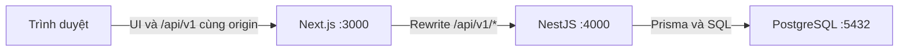

# BookingHub

BookingHub là hệ thống đặt và quản lý lịch cho salon tóc **một chi nhánh**. Phiên bản portfolio chạy local với Next.js, NestJS và PostgreSQL. Dự án chưa có bản triển khai online.

## Giao diện


[Xem màn hình chọn giờ](docs/screenshots/02-chon-gio.png) · [Lịch của khách](docs/screenshots/03-lich-cua-khach.png) · [Lịch nhân viên](docs/screenshots/04-lich-nhan-vien.png) · [Dashboard quản trị](docs/screenshots/05-dashboard-quan-tri.png)

Ảnh chụp từ ứng dụng local với dữ liệu giả.

## Chức năng theo vai trò

| Vai trò      | Luồng sử dụng                                                                                                                                                                                                                                  |
| ------------ | ---------------------------------------------------------------------------------------------------------------------------------------------------------------------------------------------------------------------------------------------- |
| **CUSTOMER** | Xem dịch vụ, nhân viên và giờ trống trước khi đăng nhập. Đăng ký hoặc đăng nhập để xác nhận đặt lịch, xem lịch sử và hủy lịch của mình theo chính sách. Khi đăng nhập giữa luồng đặt, ứng dụng quay về lựa chọn đang thực hiện nếu còn hợp lệ. |
| **STAFF**    | Xem lịch được giao theo ngày salon và trạng thái. Mở chi tiết, xác nhận, hủy kèm lý do, ghi nhận hoàn thành hoặc khách không đến khi đủ điều kiện.                                                                                             |
| **ADMIN**    | Quản lý dịch vụ, nhân viên, phân công, ca làm, khoảng nghỉ và ngày nghỉ. Xem và xử lý lịch toàn salon. Dashboard tổng hợp số lịch theo trạng thái, tỷ lệ hủy, giá trị lịch đã hoàn thành và dịch vụ phổ biến theo khoảng ngày.                 |

## Điểm kỹ thuật

- **Chống trùng tại PostgreSQL.** Migration `202611260004_appointment` dùng `btree_gist` và exclusion constraint `appointment_staff_held_excl` trên mã nhân viên và khoảng `tstzrange [start, end)` của lịch `PENDING` hoặc `CONFIRMED`. Hai lịch liền giờ có thể cùng tồn tại. Khi slot đã bị giữ, API trả HTTP 409.
- **Xử lý ghi đồng thời.** Luồng đặt lịch khóa hồ sơ nhân viên và đọc lại dịch vụ, phân công và giờ hợp lệ trong transaction trước khi ghi. Luồng sửa lịch làm việc dùng cùng khóa. Khi đổi trạng thái lịch, API kiểm tra `expectedStatus` để xử lý yêu cầu dựa trên trạng thái cũ.
- **Xác thực và phân quyền.** Browser gửi cookie phiên `HttpOnly` cùng origin. PostgreSQL lưu hash token. API kiểm tra phiên, vai trò và quyền sở hữu hoặc phạm vi phân công trên từng lịch. Yêu cầu ghi kiểm tra `Origin` và header CSRF.
- **Tính giờ trống phía backend.** Slot bắt đầu theo bước 15 phút trong múi giờ `Asia/Ho_Chi_Minh`. Toàn bộ thời lượng dịch vụ phải nằm trong một ca, tránh khoảng nghỉ, ngày nghỉ và lịch đang giữ chỗ.
- **Bảo toàn lịch sử.** Mỗi lịch lưu bản chụp tên dịch vụ, giá và thời lượng lúc đặt. Trước khi lưu thay đổi ca hoặc ngày nghỉ, backend kiểm tra lại lịch đang giữ chỗ dưới khóa và từ chối thay đổi gây xung đột. Trigger PostgreSQL ghi lịch sử trạng thái trong cùng giao dịch.

## Công nghệ

| Thành phần                            | Phiên bản             | Vai trò                                                   |
| ------------------------------------- | --------------------- | --------------------------------------------------------- |
| Node.js, pnpm                         | 22.14.0, 10.32.1      | Runtime và monorepo workspace                             |
| Next.js App Router, React, TypeScript | 16.4.6, 19.3.1, 5.9.3 | Giao diện theo vai trò và proxy API cùng origin           |
| Tailwind CSS                          | 4.3.5                 | Kiểu giao diện                                            |
| NestJS, Prisma                        | 11.2.12, 7.10.1       | REST API, kiểm tra nghiệp vụ, truy vấn và migration       |
| PostgreSQL                            | 17.12                 | Dữ liệu quan hệ và ràng buộc SQL, chạy qua Docker Compose |
| Jest, Playwright                      | 30.5.2, 1.65.1        | Unit, smoke, integration và kiểm tra trên trình duyệt     |

Phiên bản lấy từ [`.node-version`](.node-version), [`package.json`](package.json), [lockfile](pnpm-lock.yaml) và [`compose.yaml`](compose.yaml).

## Kiến trúc local



## Chạy nhanh bằng Git Bash trên Windows

Cần Git for Windows, Node.js **22.14.0**, pnpm **10.32.1** và Docker Desktop đang chạy ở chế độ Linux containers. Kiểm tra bằng `node -v`, `pnpm --version`, `docker compose version` và `docker info`. Nếu pnpm chưa đúng phiên bản, cài với `npm install --global pnpm@10.32.1` rồi mở lại Git Bash.

```bash
git clone https://github.com/demian0711/bookinghub.git
cd bookinghub

cp -n .env.example .env
cp -n apps/api/.env.example apps/api/.env
cp -n apps/web/.env.example apps/web/.env.local

pnpm install --frozen-lockfile
pnpm db:up
pnpm db:migrate
```

`cp -n` giữ nguyên file có sẵn. Nếu dùng cổng hoặc thông tin PostgreSQL khác mẫu, đối chiếu `.env` với `DATABASE_URL` trong `apps/api/.env`. Với DB mới, chạy seed ở mục dưới để có dữ liệu thử, sau đó chạy `pnpm dev` từ gốc repo.

| Địa chỉ local                         | Mục đích                                        |
| ------------------------------------- | ----------------------------------------------- |
| <http://localhost:3000>               | Web BookingHub                                  |
| <http://localhost:3000/api/v1/ready>  | Kiểm tra Next.js proxy tới NestJS và PostgreSQL |
| <http://localhost:4000/api/v1/health> | Kiểm tra tiến trình NestJS                      |
| <http://localhost:4000/api/docs>      | Swagger trong development                       |

Dừng web và API bằng `Ctrl+C` trong cửa sổ chạy `pnpm dev`, sau đó dùng `pnpm db:down` nếu muốn dừng PostgreSQL. Lệnh giữ lại Docker volume. Để chạy lại, dùng `pnpm db:up` và `pnpm dev`. Chạy `pnpm db:migrate` trước `pnpm dev` khi có migration mới.

## Tài khoản và dữ liệu demo local

Ở gốc repo, sau migration, chạy [khối lệnh seed đọc mật khẩu ẩn](docs/setup.md#xác-thực-m2). Bạn tự đặt mật khẩu 12–128 ký tự cho ba vai trò khi seed lần đầu.

| Vai trò  | Email đăng nhập mẫu                                                                             |
| -------- | ----------------------------------------------------------------------------------------------- |
| CUSTOMER | `customer@demo.bookinghub.test`                                                                 |
| STAFF    | `staff@demo.bookinghub.test`, `staff-mai@demo.bookinghub.test`, `staff-an@demo.bookinghub.test` |
| ADMIN    | `admin@demo.bookinghub.test`                                                                    |

Trên DB mới, seed tạo năm dịch vụ, ba nhân viên và ca thứ Hai đến thứ Bảy, 09:00–17:00, nghỉ 12:00–13:00. Ba tài khoản STAFF nhận mật khẩu STAFF của lượt đã tạo chúng. Seed chạy lại giữ mật khẩu hiện có. Chọn **Gội và sấy tạo kiểu** để xem cả ba nhân viên trên dữ liệu mẫu. Xem [kịch bản demo ba vai trò](docs/demo-guide.md).

## Kiểm tra

| Lệnh từ gốc repo                                   | Mục đích                                                                          |
| -------------------------------------------------- | --------------------------------------------------------------------------------- |
| `pnpm test:unit`                                   | Unit test cho múi giờ salon và biên ca/nghỉ                                       |
| `pnpm test`                                        | Smoke test API health/readiness. Cần PostgreSQL local đã áp dụng migration        |
| `pnpm test:integration`                            | Kiểm tra API với PostgreSQL, gồm phân quyền, tranh chỗ, lịch làm và vòng đời lịch |
| `pnpm test:web`                                    | Kiểm tra luồng đăng ký, đăng nhập, phiên và đăng xuất trên trình duyệt            |
| `pnpm test:e2e`                                    | Playwright kiểm tra khách, nhân viên và quản trị qua HTTPS loopback               |
| `pnpm lint`, `pnpm format:check`, `pnpm typecheck` | Kiểm tra lint, định dạng và kiểu dữ liệu                                          |
| `pnpm build`                                       | Build production tại máy local cho Next.js và NestJS                              |

Ba lệnh integration, web và E2E tự tạo PostgreSQL test riêng trong Docker, chạy migration rồi dọn container. Khi chạy Playwright trên Windows cần Chrome. Luồng HTTPS E2E cần thêm `openssl` trên PATH. Xem [setup](docs/setup.md) và [kết quả kiểm tra đã ghi nhận](docs/test-report.md).

## Tài liệu chuyên sâu

- [Thiết lập và xử lý lỗi local](docs/setup.md)
- [Luồng demo 5–10 phút](docs/demo-guide.md)
- [Quy tắc nghiệp vụ và vòng đời lịch](docs/business-rules.md)
- [Kiến trúc và sơ đồ quan hệ database](docs/architecture.md#quan-hệ-database)
- [Quyết định về session](docs/adr/0001-auth-session.md) và [chống trùng đồng thời](docs/adr/0002-booking-concurrency.md)
- [Báo cáo kiểm tra](docs/test-report.md) và [checklist phiên bản local](docs/release-checklist.md)

## Giới hạn hiện tại

- Một chi nhánh, một múi giờ salon và một dịch vụ trên mỗi lịch. Cửa sổ đặt từ hôm nay đến 29 ngày tiếp theo, theo giờ salon.
- Khách đổi lịch bằng cách hủy theo chính sách rồi đặt lại. Ca làm không qua nửa đêm.
- Chưa có thanh toán hoặc gửi email/SMS. Giá trị lịch hoàn thành trên dashboard là tổng giá lúc đặt theo trạng thái, chưa phản ánh giao dịch thanh toán.
- Phiên bản hiện tại chạy local. Các kiểm tra build production và HTTPS loopback được thực hiện trên máy kiểm thử.
