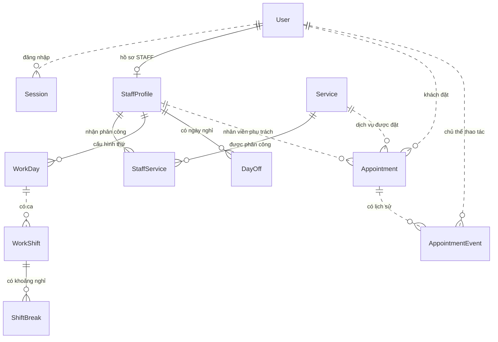

# Kiến trúc BookingHub

## Thành phần và luồng gọi API

BookingHub là monorepo pnpm gồm `apps/web` và `apps/api`. Docker Compose khởi động PostgreSQL 17.12 trên loopback. Mặc định, trình duyệt vào Next.js tại `:3000`, Next.js rewrite `/api/v1/*` đến NestJS tại `:4000`, và NestJS truy cập PostgreSQL tại `:5432`.

| Thành phần                                  | Trách nhiệm                                                                                                                                                                                                                   |
| ------------------------------------------- | ----------------------------------------------------------------------------------------------------------------------------------------------------------------------------------------------------------------------------- |
| [Next.js](../apps/web/)                     | App Router hiển thị danh mục công khai, luồng khách, khu vực nhân viên và quản trị. Các request từ browser dùng cùng origin. [Rewrite](../apps/web/next.config.ts) lấy server origin của API từ `API_ORIGIN`.                 |
| [NestJS](../apps/api/src/)                  | Module auth, catalog, schedule và appointments xử lý REST, xác thực DTO, phân quyền và nghiệp vụ. Appointments cũng cung cấp dữ liệu tổng hợp cho dashboard. API công khai có health và readiness, Swagger bật ở development. |
| [PostgreSQL và Prisma](../apps/api/prisma/) | Prisma quản lý schema, migration và nhiều truy vấn. SQL trực tiếp dùng cho khóa dòng, ghi lịch với exclusion constraint và các chức năng cần thao tác đặc thù PostgreSQL.                                                     |

Endpoint `/api/v1/health` xác nhận tiến trình đang chạy. `/api/v1/ready` truy vấn PostgreSQL và có thể trả 503 trong khi liveness vẫn trả 200. Browser tra cứu giờ trống từ backend, nơi thực thi toàn bộ quy tắc và quyền truy cập.

## Phiên và quyền trên dữ liệu

Đăng nhập sinh token ngẫu nhiên, gửi qua cookie `bookinghub_session` có `HttpOnly`, `SameSite=Lax`, path `/api/v1` và `Secure` trong chế độ production. PostgreSQL lưu hash token, hạn phiên và thời điểm thu hồi. API đọc trạng thái tài khoản và vai trò khi xác thực. Yêu cầu ghi phải có đúng `Origin` cấu hình và `X-BookingHub-CSRF: 1`.

Controller áp dụng guard theo vai trò. Service giới hạn tài nguyên theo khách sở hữu lịch hoặc nhân viên được giao trên lịch. Admin truy cập các chức năng quản trị của một salon. Chi tiết trong [ADR session](adr/0001-auth-session.md) và [quy tắc nghiệp vụ](business-rules.md).

## Ghi lịch, sửa cấu hình và xử lý trạng thái

1. API quy đổi ngày địa phương theo `Asia/Ho_Chi_Minh` và đọc phân công, ca, khoảng nghỉ, ngày nghỉ và lịch đang giữ chỗ. Backend trả các slot hợp lệ trên lưới 15 phút.
2. Trong transaction đặt lịch, API khóa dòng `StaffProfile` với `FOR UPDATE`, đọc có khóa dịch vụ và tài khoản khách, rồi đối chiếu lại cấu hình và giờ yêu cầu. Lịch mới ở `PENDING`. API lưu bản chụp tên, giá và thời lượng dịch vụ từ DB.
3. Exclusion constraint áp dụng khi PostgreSQL ghi lịch. Trường hợp slot giao với lịch đang giữ chỗ cho cùng nhân viên, API trả 409 `APPOINTMENT_SLOT_TAKEN`. Sửa ca hoặc ngày nghỉ lấy cùng khóa nhân viên, kiểm tra lại lịch chịu ảnh hưởng trước khi ghi và trả 409 nếu thay đổi sẽ xung đột.
4. Khi cập nhật trạng thái, API kiểm tra vai trò, phạm vi lịch, thời gian và `expectedStatus`. Trigger ghi sự kiện trạng thái và thông tin liên quan trong cùng transaction. Dashboard tổng hợp theo **ngày bắt đầu lịch tại salon**. Chỉ lịch `COMPLETED` góp vào tổng giá trị hoàn thành.

[Xem ADR chống trùng lịch](adr/0002-booking-concurrency.md) và [migration lịch hẹn](../apps/api/prisma/migrations/202611260004_appointment/migration.sql).

## Quan hệ database

- `StaffProfile` liên kết `User` bằng khóa ngoại ghép `(userId, role)` và SQL yêu cầu role `STAFF`. `StaffService` là bảng nối với khóa chính `(staffId, serviceId)`.
- `WorkDay` có khóa chính `(staffId, weekday)`, được `WorkShift` tham chiếu bằng cả hai cột. Khoảng nghỉ gắn với `WorkShift` và dùng khóa `(shiftId, startMinute)`. Thứ theo ISO 1–7, ca và khoảng nghỉ dùng số phút trên đồng hồ salon. `DayOff` dùng khóa `(staffId, date)` với kiểu PostgreSQL `date`.
- `Appointment` lưu `startAt` và `endAt` dạng `timestamptz(3)`. SQL kiểm tra giờ kết thúc bằng giờ bắt đầu cộng thời lượng và dùng `btree_gist` để cấm giao nhau của khoảng nửa mở `[startAt, endAt)` theo `staffId` đối với `PENDING` và `CONFIRMED`.
- `AppointmentEvent` tham chiếu lịch và tài khoản thao tác. Trigger `appointment_record_status` ghi sự kiện tạo lịch và đổi trạng thái. Migration vòng đời bổ sung lý do hủy. Chỉ mục phục vụ truy vấn theo khách, nhân viên và ngày bắt đầu lịch.

[Sơ đồ Prisma](../apps/api/prisma/schema.prisma) · [SQL migrations](../apps/api/prisma/migrations/)
